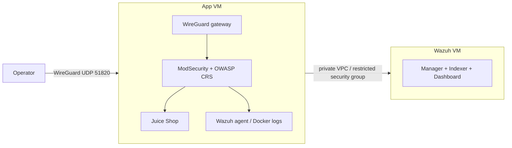

# Juice Shop + WAF + Wazuh lab (AWS, Terraform)

## What this builds

A two-VM AWS lab provisioned by Terraform, with application and Wazuh services bootstrapped automatically.  
The operator connects privately over WireGuard; Juice Shop is only reached through ModSecurity/OWASP CRS.  
A Python verifier checks readiness, allowed/blocked WAF behavior, and that a fresh request marker reaches Wazuh alerts.



## Prerequisites

- AWS account and configured AWS CLI credentials with least-privilege permissions for the lab's EC2, VPC, IAM, SSM, and S3 operations. Do not use root credentials.
- Terraform 1.10+, AWS CLI v2, WireGuard tools (`wg`, `wg-quick`; macOS also needs `wireguard-go`), `curl`, `openssl`, and Python 3.10+.
- An accessible S3 Terraform state bucket, encrypted and versioned, with public access blocked and support for Terraform S3 lock files. The provided bucket is checked, not configured, when `TF_STATE_BUCKET` is set.
- On macOS, permission to create the WireGuard interface with `sudo`; internet access from both VMs to install packages and images.
- Confirm regional service quota and account/free-plan eligibility for the configured Wazuh instance type before deployment.

## Commands

Set AWS credentials before running. Set `OPERATOR_IP_CIDR` if the detected public IP is not the intended WireGuard allowlist. Keep generated `.secrets/` unchanged while reusing a deployment.

```sh
# Deploy infrastructure, connect the VPN, then run end-to-end verification
AWS_REGION=ap-southeast-2 TF_STATE_BUCKET=<your-existing-bucket> bash ./lab.sh deploy

# Re-run verification against the existing lab
AWS_REGION=ap-southeast-2 TF_STATE_BUCKET=<your-existing-bucket> bash ./lab.sh verify

# Disconnect the VPN and destroy lab infrastructure after collecting evidence
AWS_REGION=ap-southeast-2 TF_STATE_BUCKET=<your-existing-bucket> bash ./lab.sh destroy
```

The destroy command intentionally retains the S3 state bucket. Review the remote state and Terraform plan before applying to an existing deployment; instance bootstrap changes are not automatically applied to running instances.

## How each requirement is met

- **Application:** Docker Compose runs Juice Shop behind the proxy; the container port is not published — [terraform/app-bootstrap.sh.tftpl](terraform/app-bootstrap.sh.tftpl).
- **Wazuh:** separate VM runs the Wazuh manager, Indexer, and dashboard; bootstrap configures credentials, agent enrollment, Docker JSON log collection, marker alert rule, and persistent Docker volumes — [terraform/wazuh-bootstrap.sh.tftpl](terraform/wazuh-bootstrap.sh.tftpl) and [terraform/app-bootstrap.sh.tftpl](terraform/app-bootstrap.sh.tftpl).
- **VPN/private access:** WireGuard gateway, forwarding/NAT, and restricted ingress are provisioned; local deploy/verify connects the operator — [terraform/app-bootstrap.sh.tftpl](terraform/app-bootstrap.sh.tftpl), [terraform/main.tf](terraform/main.tf), and [lab.sh](lab.sh).
- **WAF/origin protection:** ModSecurity with OWASP CRS fronts Juice Shop, a deterministic rule blocks `lab_block=1` with HTTP 403, and security groups restrict app HTTP to the gateway path — [terraform/app-bootstrap.sh.tftpl](terraform/app-bootstrap.sh.tftpl) and [terraform/main.tf](terraform/main.tf).
- **Cloud security/state/secrets:** encrypted EBS, IMDSv2, security groups, EC2 role, SSM SecureString parameters, remote S3 backend and native lock files are configured in [terraform/main.tf](terraform/main.tf), [terraform/backend.tf](terraform/backend.tf), and [lab.sh](lab.sh). Generated local secrets and Terraform state are excluded by [.gitignore](.gitignore).
- **Verifier:** readiness checks, unique marker creation, allowed/blocked request checks, Indexer search, bounded timeouts, and nonzero errors — [scripts/verify_lab.py](scripts/verify_lab.py); helper unit tests — [tests/test_verify_lab.py](tests/test_verify_lab.py).
- **CI/CD:** Terraform format/validation, verifier tests, Trivy, and Gitleaks run in [ci.yml](.github/workflows/ci.yml); manual deployment is gated on checks and configured for OIDC/protected environment and a dedicated Mac runner in [deploy.yml](.github/workflows/deploy.yml).

## Security and TLS

- **Inbound network:** the app VM's WireGuard UDP 51820 is limited to the configured operator IPv4 CIDR. App TCP 80 is accepted from the app security group for VPN-forwarded traffic; the Wazuh VM accepts its service ports (TCP 443, 9200, 1514, 1515 and UDP 1514) from the app security group. No public SSH ingress is configured. The Wazuh VM has a public address for outbound bootstrap connectivity, but its Wazuh services are not open to the internet.
- **Outbound network:** security groups allow HTTP/HTTPS for upstream package/image and AWS API access, DNS to the VPC resolver, and the required app-to-Wazuh service traffic.
- **Identity:** EC2 uses an instance profile with Systems Manager access and permission to read lab parameters. Both instances currently share that profile and can read all three lab SecureString parameters; split it into per-instance least-privilege roles before production use.
- **Secret storage:** generated keys/passwords are stored locally under ignored `.secrets/` with restrictive directory/file permissions and passed through Terraform variables into SSM SecureString parameters. Terraform state includes sensitive values, so the remote S3 backend must remain private, encrypted, versioned, and access-controlled. Never commit secrets, state, plans, or credentials.
- **Encrypted paths and TLS caveats:** WireGuard encrypts operator-to-gateway traffic. The private app/WAF HTTP hop and Indexer connection travel inside the VPN/VPC path. Wazuh uses deployment-generated self-signed certificates; the verifier disables certificate validation for the private Indexer connection. This is a documented disposable-lab tradeoff, not a production TLS configuration. Use trusted certificates and normal certificate validation for production.

## Estimated cost

**A verified numeric estimate has not been recorded.** No AWS Pricing Calculator result is available in the repository, and actual usage has not been measured; do not treat a guessed number as a quote. Before submission, calculate the short-run cost in the AWS Pricing Calculator for **ap-southeast-2** and record both the calculator inputs and expected run hours here.

Include:

- App EC2: `t3.small`; Wazuh EC2: planned `m7i-flex.large` (2 vCPU/8 GiB), subject to account eligibility and quota.
- 110 GiB total gp3 root disks: 30 GiB app + 80 GiB Wazuh.
- Two public IPv4 addresses during the run, outbound data transfer, and S3 state storage/requests/version history.
- Run duration and any free-plan/trial credits only after confirming account eligibility. Destroy the EC2/network resources after assessment; the versioned state bucket is retained and may still incur a small storage charge.

**Actual hours run / actual billed cost:** not yet recorded. Update after deployment and billing data are available. The Wazuh instance size is unverified; a prior attempt to resize to `t3.xlarge` was rejected under the account's Free plan restriction. The configured `m7i-flex.large` is below Wazuh's 4-vCPU starting recommendation.

## Actual effort

The assignment timebox was 1–2 hours. **Actual focused time was not tracked**, so no build/debug/documentation hour split can be reported reliably. Fill in actual elapsed time before sharing this as a completed submission:

- Build/implementation: not measured.
- Debugging/testing: not measured.
- Documentation/submission: not measured.
- Total focused effort: not measured.

## AI use

AI assistance generated and refined Terraform infrastructure, VM bootstrap scripts, the Python verifier and unit tests, GitHub Actions workflows, and documentation. The changes were reviewed and integrated into the repository; formatting, validation, unit tests, and CI checks were run where recorded. The owner remains responsible for reviewing the AWS plan and IAM scope, checking account-specific capacity and billing, and completing live deployment/evidence checks. AI-generated code is not a substitute for the pending AWS runtime verification.

## Incomplete items / known gaps

- The latest source patch has not been applied to AWS; the end-to-end verifier has not passed for the current deployment. VPN access, WAF outcomes, fresh Wazuh event delivery, direct-origin rejection, and teardown are not evidenced.
- The AWS account's `m7i-flex.large` eligibility/quota is unconfirmed; the current instance may still be `t3.small`. The configured size is below Wazuh's 4-vCPU starting recommendation. A previous larger resize was rejected by the Free plan restriction.
- GitHub Actions CI has a previously recorded passing run, but current live deployment was not performed. GitHub OIDC role/provider, protected environment settings, and Mac runner registration remain pending; local deployment is an alternative.
- The verifier bypasses certificate validation for the self-signed private Indexer certificate. The Wazuh stack is a single node, not highly available.
- Both VMs share one EC2 role with access to all lab SecureString parameters; acceptable only for this disposable lab, not production.
- No numeric Sydney price estimate, actual billed cost, actual run hours, or measured effort is available yet.
- Replacing the Wazuh VM deletes its root disk and Docker volumes unless they are snapshotted. A deployment rerun preserves them only when the instance is not replaced.

## Evidence

No redacted evidence files are currently recorded in `docs/evidence/`. Add the following after a successful local run; do not include keys, passwords, authorization headers, AWS credentials, or Terraform state:

- Active tunnel (`sudo wg show`) and an application request through VPN.
- Normal allowed request and deterministic `?lab_block=1` response showing HTTP 403.
- Verifier output with `Verified marker: ...` and the matching Wazuh alert in the dashboard/Indexer.
- Confirmation that direct public HTTP/HTTPS access to the app origin is rejected and UDP 51820 is restricted to the intended operator CIDR.

Current project status and the complete owner checklist: [CHANGES_AND_OWNER_CHECKLIST.md](CHANGES_AND_OWNER_CHECKLIST.md). General deployment guidance: [README.md](README.md).
